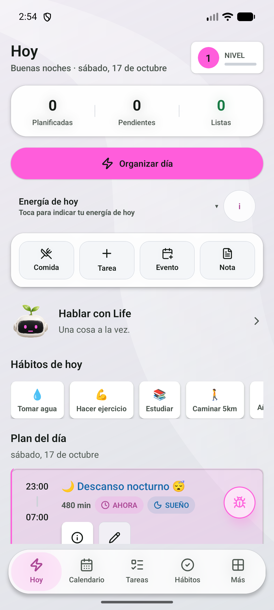
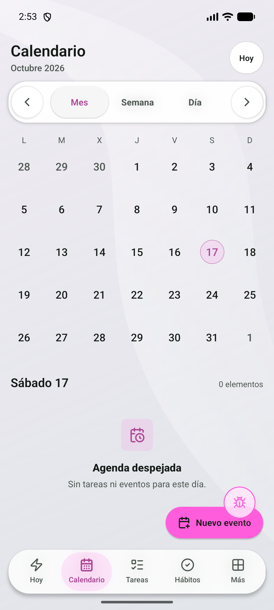
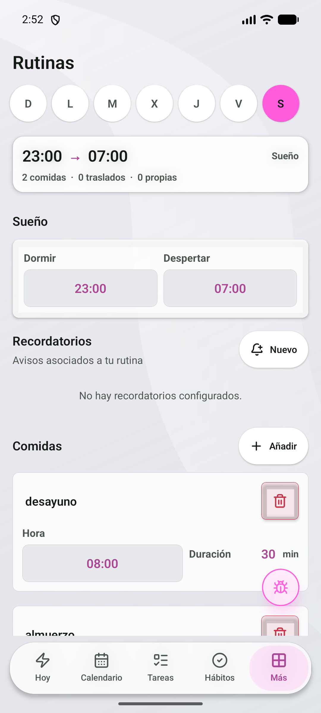
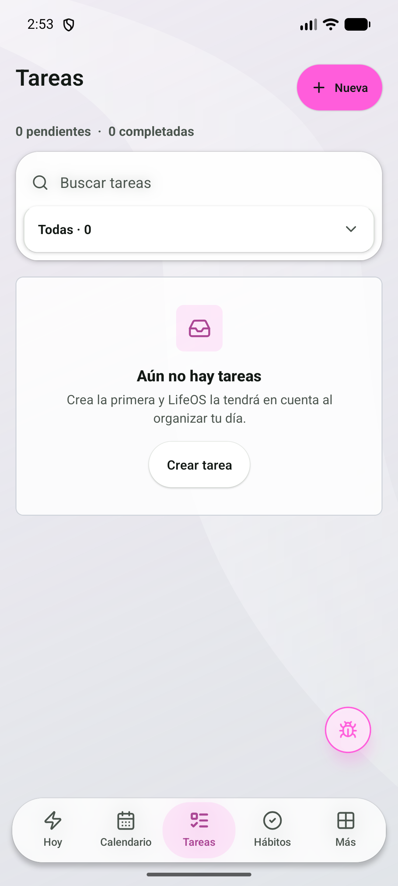
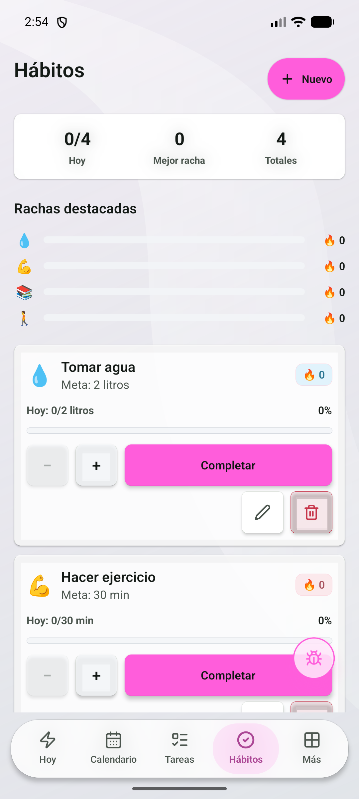
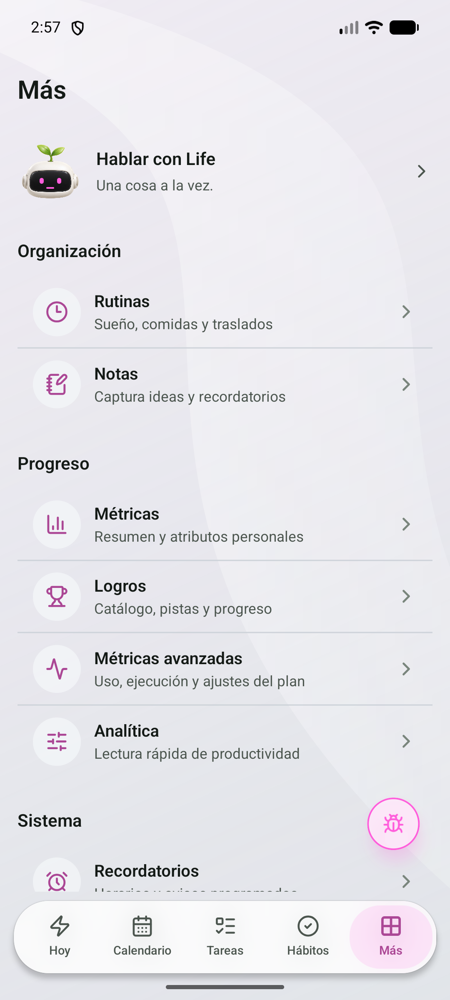
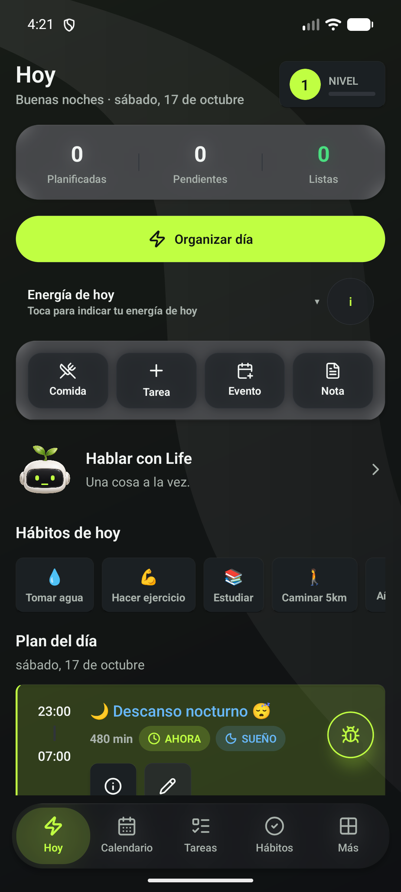
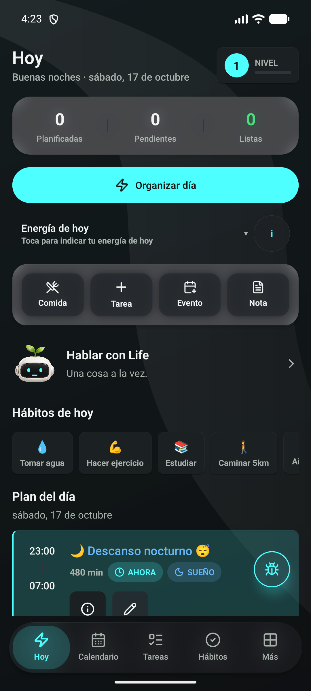

  

<h1 align="center">LifeOS</h1>

<strong>Tu día, con un poco más de orden.</strong> Tareas, horarios, rutinas y hábitos en una app para Android.

  
  
  

  <a href="https://github.com/AlanBerrios/LIFEOS-releases/releases/tag/v4.5.1"><strong>Descargar LifeOS 4.5.1</strong></a>
  &nbsp; · &nbsp;
  <a href="https://github.com/AlanBerrios/LIFEOS-releases/releases">Todas las versiones</a>
  &nbsp; · &nbsp;
  <a href="#reportar-un-problema">Enviar una sugerencia</a>

---

## Una mirada a LifeOS

Galería conservada de la revisión 4.3.4, registrada en un emulador Android con datos de ejemplo. La apariencia puede variar según el tema, el color y tu teléfono. Estas imágenes no sustituyen las pruebas en un teléfono físico.

<table>
  <tr>
    <td align="center"><strong>Hoy</strong> </td>
    <td align="center"><strong>Calendario</strong> </td>
    <td align="center"><strong>Rutinas</strong> </td>
  </tr>
  <tr>
    <td align="center"><strong>Tareas</strong> </td>
    <td align="center"><strong>Hábitos</strong> </td>
    <td align="center"><strong>Más</strong> </td>
  </tr>
</table>

## A tu estilo

La misma pantalla con distintas preferencias reales de LifeOS 4.3.4. Puedes cambiar el tema claro u oscuro y el color de acento desde **Ajustes → Apariencia**; también dispone de fondos propios, foto personal opcional y reducción de transparencias.

<table>
  <tr>
    <td align="center"><strong>Claro · rosa</strong> </td>
    <td align="center"><strong>Oscuro · lima</strong> </td>
    <td align="center"><strong>Oscuro · cian</strong> </td>
  </tr>
</table>

## Qué puedes organizar

| Tu día | Tus compromisos | Tu progreso |
| --- | --- | --- |
| Planificación local y bloques de tiempo | Eventos, ICS y calendarios del teléfono | Hábitos, métricas y logros |
| Tareas pendientes y avances parciales | Sueño, comidas y traslados | Notas y recordatorios |
| Reorganización de la agenda | Rutinas semanales personalizadas | Asistente de texto **Life** |

Life es tu asistente de texto opcional: ayuda a ordenar pendientes y preparar evaluaciones. Usa Gemini con internet, cuota disponible y una clave propia que configuras en el teléfono. Los cambios se presentan como propuestas para confirmar. No hace falta configurar IA para utilizar la organización habitual de la app.

## Empieza sin perderte

1. Abre el **? de Hoy** o el tutorial al inicio de **Ajustes**. El recorrido ilumina los controles y guía la creación de tareas, eventos, hábitos, rutinas y notas.
2. En **Calendario → Calendarios del teléfono**, elige cuáles quieres añadir y revisa la previsualización. También puedes importar un ICS. LifeOS solo lee el calendario del teléfono: no lo modifica y la actualización es manual.
3. Añade tus pendientes y pulsa **Organizar día** en Hoy. La planificación habitual se calcula en el dispositivo.
4. Para conversar, configura **Life** y prueba los ejemplos de abajo. Revisa siempre la propuesta antes de confirmar.

## Life, con ejemplos

| Lo que necesitas | Qué puedes pedir |
| --- | --- |
| Vaciar pendientes de la cabeza | «Crea una tarea para estudiar cálculo y otra para comprar materiales». |
| Preparar una evaluación | «Tengo una PEP de cálculo el viernes 30 de octubre de 2026 a las 10:00; propón tres sesiones de 45 minutos». |
| Personalizar un compromiso | «Cambia el color de mi presentación a azul». |
| Ajustar la apariencia | «Propón cambiar al tema claro». |
| Entender tu semana sin usar IA | Pulsa el botón de lista en Life: revisa los próximos siete días localmente, sin enviarlos a Gemini. |

Las sesiones de preparación son estimaciones: respetan el descanso, el sueño y los compromisos, pero no conocen tu temario ni garantizan resultados. Las sesiones que editaste quedan protegidas. Life no cambia claves, consentimiento, permisos de Android ni eventos de los calendarios del teléfono.

## Instalar o actualizar

1. **Exporta una copia desde Ajustes** y abre la [versión de revisión 4.5.1](https://github.com/AlanBerrios/LIFEOS-releases/releases/tag/v4.5.1) desde tu teléfono.
2. En **Assets**, descarga el archivo terminado en `-review.apk`. No descargues los archivos **Source code**.
3. Abre la APK y, si Android lo pide, autoriza la instalación desde ese navegador o gestor de archivos.
4. Confirma **Instalar** o **Actualizar** en el instalador de Android.

**Si ya usas una APK de revisión compatible (mismo paquete y firma), actualiza encima. No desinstales ni borres los datos para actualizar.** La APK es independiente: no necesita Expo Go ni una computadora encendida.

La app comprueba nuevas versiones al arrancar. También puedes buscarlas desde **Ajustes**. Descargar una actualización no la instala en silencio: Android siempre requiere tu confirmación.

> **¿La 4.3.2 se quedó al 100%?** Descarga e instala esta revisión desde el navegador. La 4.3.4 incorpora una corrección de la verificación posterior a la descarga y explica el permiso de instalación; su aceptación en teléfono físico sigue pendiente. El fallo de la versión antigua no puede corregirse sin actualizarla.

## Novedades de la 4.5.1

Corrige Life después de probar la 4.5.0 con Gemini real:

- **Cumpleaños y horarios desde Life:** los eventos de todo el día y las clases semanales leídas de un PDF o una foto ya no fallan con «Campo no permitido». Las clases incluyen su fecha de término.
- **Consultas sin cambios:** si pides resumir un documento, consultar tu agenda o dices «no propongas cambios», Life no propone ninguna acción. Tampoco ofrece preparar una evaluación que no pediste solo porque aparece en tu agenda o en un documento.
- **Avisos más claros:** pedir que desactive un aviso concreto genera la propuesta directamente. La confirmación adicional la sigue haciendo la app antes de guardar.
- **Mensajes honestos:** Life no dice «he desactivado» ni «he creado» antes de que confirmes.

**Límites:** probado con el modelo `gemini-3.1-flash-lite` y datos de ejemplo; otro modelo puede comportarse distinto. Con una clave gratuita, muchas consultas seguidas pueden agotar el límite por minuto: espera y reintenta. Pendiente la prueba en teléfono.

## Novedades de la 4.5.0

- **Tutorial más completo:** pasos dentro de los formularios para explicar nombres, duración, fechas, metas y repetición, con enfoque del campo correspondiente.
- **Preparación académica con Life:** propuestas de sesiones para evaluaciones, presentaciones, laboratorios y entregas, calculadas en tiempo disponible. No usa tus días de descanso ni mueve sesiones que editaste.
- **Revisión local de la semana:** detecta posibles choques, plazos sin tiempo reservado y evaluaciones sin preparación. Funciona sin Gemini y no modifica la agenda.
- **Más personalización por conversación:** colores y emoji de tareas/eventos y una lista controlada de ajustes. Los cambios siempre se confirman; los avisos requieren confirmación adicional.
- **Eventos de todo el día desde Life:** distingue un cumpleaños de un evento con horario para no bloquear el descanso por error.
- **Conversaciones más claras:** conserva el mensaje cuando falla una consulta, permite reintentar y diferencia respuestas incompletas, filtros y problemas del servicio. Una respuesta parcial nunca se aplica.
- **Preparación protegida al restaurar y deshacer:** valida fechas reales con zona y los vínculos entre sesiones y evaluaciones.

**Límites de esta revisión:** pendiente de prueba en teléfono, incluyendo teclado, tutorial, accesibilidad y uso con calendarios reales. La prueba posterior con Gemini real encontró fallos que corrige la 4.5.1. Las capturas conservadas son de 4.3.4, no muestran estas novedades.

### Mejoras anteriores conservadas

- Tutorial por fases con foco, pausa y reanudación, disponible desde Hoy y Ajustes.
- Calendarios del teléfono con selección, previsualización, permiso de solo lectura y actualización manual. No se comparten con Life por defecto.
- Deshacer persistente para operaciones compatibles; puede bloquearse si los datos cambiaron después. No cubre todos los ajustes, rutinas, ICS ni reorganizaciones.
- Formularios y selectores con acciones separadas del scroll, calendario Mes/Semana/Día y personalización por temas y colores.
- Actualizador con comprobación de integridad y confirmación en el instalador de Android.
- Botón de reportes arrastrable, sin registro, con captura temporal.

## Reportar un problema

Pulsa el **bicho flotante** dentro de LifeOS, escribe qué pasó y envía el reporte. También puedes enviar ideas y observaciones visuales.

- No necesitas crear una cuenta ni iniciar sesión.
- Puedes revisar, quitar o repetir la captura antes de enviarla.
- El envío usa un servicio externo de reportes; no añade capturas a este repositorio.
- La captura usa caché temporal, no la galería. Tras confirmar el envío se intenta eliminar la copia local; si falla la conexión, puede conservarse temporalmente para reintentar.

Antes de enviar, comprueba que la captura no incluya claves, conversaciones ni documentos que no quieras compartir con el desarrollador.

La retención y el procedimiento de eliminación remota siguen pendientes de definir antes de ampliar la distribución. Borrar datos de la app no elimina los reportes ya enviados.

## Preguntas frecuentes

<strong>¿Por qué la APK pesa alrededor de 53 MiB?</strong>

Es la app completa, no un parche. Esta revisión incluye las arquitecturas `arm64-v8a` y `x86_64`, sin duplicar las bibliotecas nativas de las variantes de 32 bits. El tamaño no indica que falten funciones. Un teléfono exclusivamente de 32 bits no es compatible con esta APK.

<strong>¿Está publicada en Google Play?</strong>

Todavía no. Estas son APK de revisión, con firma de pruebas, destinadas a probar y mejorar LifeOS. No representan una certificación de estabilidad ni una versión final de producción.

<strong>¿Dónde está el código fuente?</strong>

Este repositorio contiene únicamente distribución, imágenes y el manifest de actualizaciones. El código de la aplicación permanece en un repositorio privado. Los ZIP generados automáticamente por GitHub no contienen el proyecto de LifeOS.

<strong>¿Cómo compruebo que descargué la APK correcta?</strong>

Cada release incluye el SHA-256 del archivo. El actualizador de la app comprueba el tamaño y ese hash antes de ofrecer la instalación. Descarga únicamente desde los enlaces de este repositorio.

---

Desarrollado por <a href="https://github.com/AlanBerrios">Alan Berrios</a>. En desarrollo activo. Tu experiencia en el teléfono ayuda a decidir la próxima mejora.

